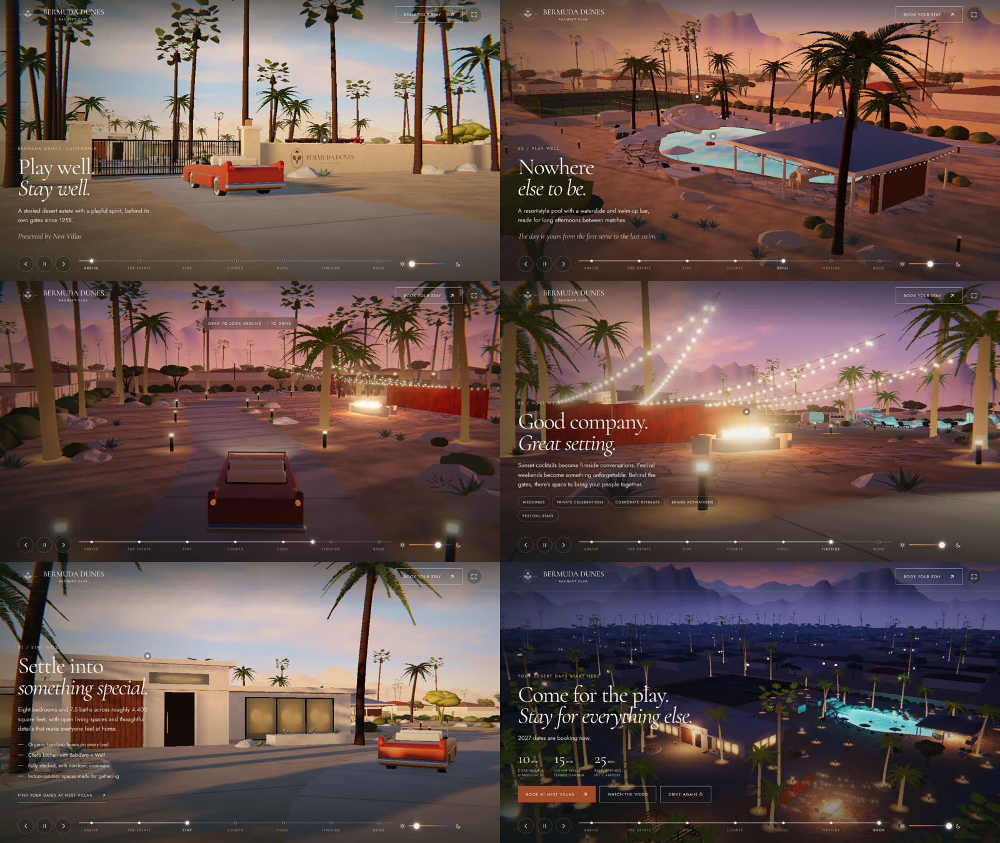
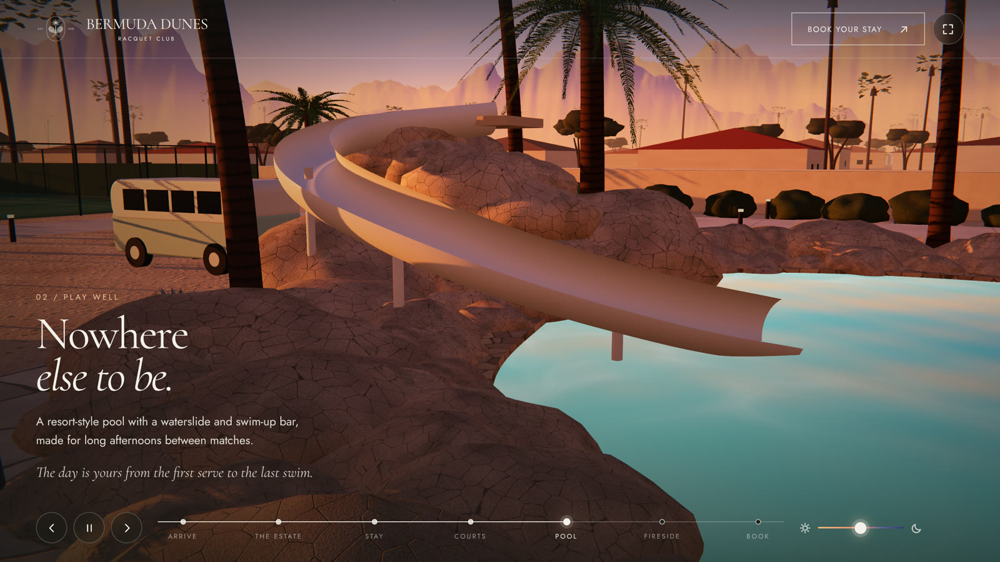

# The Estate Drive: Bermuda Dunes Racquet Club

An interactive 3D drive through the Bermuda Dunes Racquet Club estate, built to embed in the
[bermudadunesracquet.com](https://bermudadunesracquet.com/#stay) site. A '58-style convertible in the
site's clay red drives from the street, through the gates and around the grounds. It stops at seven
points, and the light moves from golden hour to after hours along the way.



`index.html` is a single file that needs no build step and no server code. It loads Three.js and the
fonts from CDNs, and the crest and hotspot photos from the club's site.

**Fully self-contained copy:** `bermuda-dunes-3d-tour.html` (1.8 MB) has everything inside it. Three.js
r170 is bundled and minified into the page, and the fonts, crest and hotspot photos are embedded. It
works opened straight from disk, emailed, or uploaded anywhere. Only the booking links and the YouTube
film need a connection. Rebuild it after editing `index.html`:

```sh
npm install --no-save three@0.170.0 esbuild@0.24.0
node build-standalone.mjs
```

A second version built from the real estate film and photos, with the same stops and copy, is in
[`../bermuda-dunes-film`](../bermuda-dunes-film).

## The drive

| Stop | What you see | Copy from the site |
| --- | --- | --- |
| Arrive | The car pulls up to the gates and the halo-lit crest sign | "Play well. Stay well." |
| The Estate | A drone shot down the palm allée to the residence | "The Racquet Club, Reimagined." ~3 acres, 8 bedrooms, 7.5 baths |
| Stay | The midcentury residence, warm light in the glass | "Settle into something special." |
| Courts | Aerial of the tennis court, two pickleball courts and the putting green | "A love of the game." |
| Pool | The lagoon pool, waterslide, swim-up bar and cabana at sunset | "Nowhere else to be." |
| Fireside | Corten wall, fire table and string lights at dusk | "Good company. Great setting." |
| Book | A crane shot over the lit estate at blue hour | "Come for the play. Stay for everything else." |

Every headline, fact and drive time comes from the current site. The layout of the grounds is an
interpretation of the site's photos and the estate video, not a survey.

**Controls:** drag to look around · Space to pause or resume · ← → to skip between stops · hold ↑ ↓ to
drive freely · click a stop on the timeline to go there · drag the sun/moon slider to set the time of
day (Auto puts it back on the drive's timeline) · click a pulsing hotspot to see the real photo.

## Embedding

Host `index.html` anywhere static, for example as `/drive/index.html` on the same site. Then drop it
into a section with an iframe:

```html
<iframe
  src="/drive/?brand=0"
  title="Take the scenic route: a 3D drive through Bermuda Dunes Racquet Club"
  style="display:block;width:100%;aspect-ratio:16/9;min-height:520px;border:0"
  allow="fullscreen; autoplay"
  loading="lazy"></iframe>
```

- `allow="fullscreen"` turns on the full screen button. Without it, the button hides itself.
- `allow="autoplay"` lets the "Watch the video" dialog start the YouTube film straight away.
- The drive waits behind a "Start the drive" button, so nothing moves until a visitor asks.
- It stops rendering when it scrolls out of view or the tab is hidden.
- Inside an iframe, vertical swipes scroll the host page, so a phone visitor doesn't get stuck.
- Layouts were checked at 1280 × 720, 800 × 450 (a 16:9 embed) and 390 × 844 (a phone). On phones the card and controls stack.

### URL options

| Parameter | Effect |
| --- | --- |
| `brand=0` | Hides the crest and wordmark in the corner (use it when the host page already shows them) |
| `autostart` | Skips the intro and starts driving |
| `chapter=arrive\|estate\|stay\|courts\|pool\|gather\|book` | Opens parked at that stop, for deep links such as `?chapter=pool` next to the Play section |
| `time=golden\|sunset\|dusk\|night` or `0`–`1` | Locks the time of day |
| `paused` | Starts with auto-drive off, so the car waits at each stop |
| `quality=ultra\|high\|balanced\|low` | Picks a rendering preset (see below). Ultra is the default on desktop, balanced on phones and tablets |
| `scale=1.5` | Renders above the screen's pixel density (0.5–2), for extra-sharp stills and screen recordings |
| `debug` | Shows the preset, frame rate, resolution, MSAA and position |

## What it loads

- **Three.js r170** from jsDelivr (`three@0.170.0`, pinned) and **Cormorant + Jost** from Google
  Fonts. Cormorant and Jost are the faces the site already uses.
- **The crest and the popover photos** from `https://bermudadunesracquet.com/assets/`. If the file moves
  to another host, or the asset paths change, edit `ASSET` near the top of the script.
- **Booking links** go to `https://www.nestvillas.com/villas`, and the film is YouTube `z86pMY77Dsc`.
  Both are constants at the top of the script.

Everything else is generated in the browser: the palms, rocks, house, courts, pool, car, sky,
mountains and textures. The surface textures (decomposed granite, concrete, flagstone, stucco, wood,
corten, palm bark, asphalt, turf, granite boulders and foliage) are rendered on the GPU at load, each
with a matching normal map. No 3D models or image textures are downloaded. A browser without WebGL 2, or
one where the CDN is blocked, gets a still frame with the video and booking buttons instead.

## Resolution and quality



Everything runs at the highest resolution by default. Performance tuning comes next. The presets:

| | Ultra (desktop default) | High | Balanced (phone default) | Low |
| --- | --- | --- | --- | --- |
| Pixel density | Screen density, up to 3× | Up to 2×, 8.3 MP cap | Up to 2×, 4.2 MP cap | 1.25×, 2.1 MP cap |
| Anti-aliasing | 8× MSAA (4× on 2× screens) + alpha-to-coverage leaves | 4× MSAA + alpha-to-coverage | 4× MSAA | none |
| Shadows | 4 cascades: 4096 + 3 × 2048 | 3 cascades × 2048 | one 2048 map | one 1024 map |
| Surface textures | 2048 px (ground, concrete, flagstone), 1024 px others, all normal-mapped | 1024 px | 512 px | 256 px |
| Court, signage, fronds | Court at ~100 px/m, 4× canvases | 2× canvases | 1× | 1× |
| Sky reflections | 1024 px cube | 512 px | 256 px | 256 px |
| Geometry | ~2.5× segments, rounded architectural edges, 980-face boulders | ~1.6× | 1× | 0.7× |
| Drops resolution when slow | no | no | yes | yes |

Ultra also uses anisotropic filtering at the GPU's maximum and lighter film grain and lens fringing, so
fine detail survives.

**Budget to tune next:** on a 2560 × 1440 screen, ultra holds roughly 1.1 GB of GPU memory. That is
about 300 MB of frame buffers (8× MSAA at half float), 250 MB of reflection maps, 235 MB of shadow maps,
230 MB of generated textures and 110 MB of canvas textures. Each frame also renders the scene into four
shadow cascades. Those are the levers for the performance pass; `quality=high` and `balanced` show
where each one lands.

If the graphics chip drops the 3D context (usually running out of memory) or the scene fails to build, the page reloads itself one preset lower.

With `prefers-reduced-motion`, the camera drift and intro orbit are off and the intro swoop is shorter.

## Editing

The stops, their copy, camera shots and time of day live in the `CH` array. Hotspots are in `HOT`.
The route is the `ROUTE` list of points in metres; the gate is at `z = 62` and the estate runs about
132 × 124 m. The light keyframes for golden hour, sunset and after hours are in `KEYS`.
