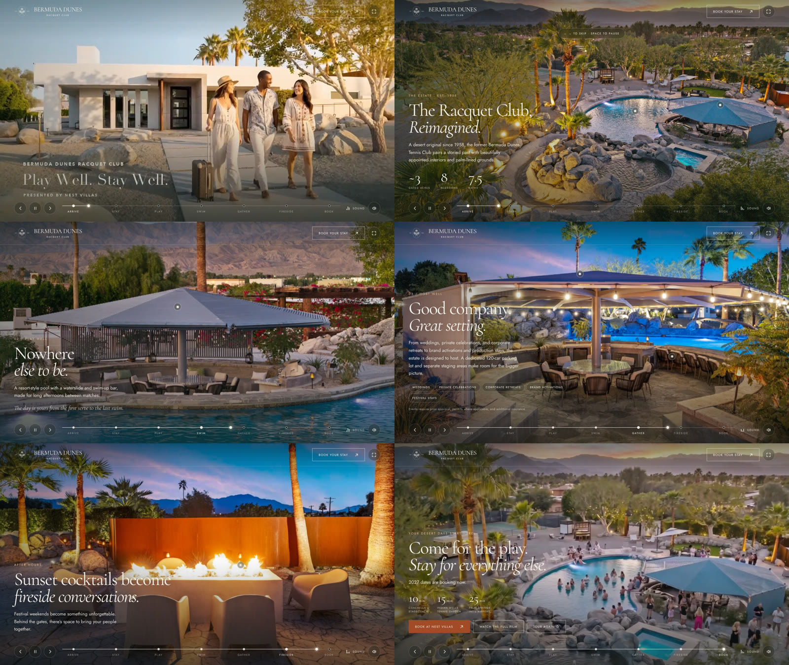

# The Estate Tour: Bermuda Dunes Racquet Club (real footage)

The footage version of the estate drive. It takes the same seven stops and the same copy as the 3D
version in [`../bermuda-dunes-drive`](../bermuda-dunes-drive), but every frame is real. Each stop plays
a stretch of the estate film, then holds on one of the site's photographs with a slow zoom, the stop's
card and hotspots. The film's own soundtrack plays underneath the whole way.



## The stops

| Stop | Footage (from the 60 s estate film) | Hold photo | Card |
| --- | --- | --- | --- |
| Arrive | 0:00–0:04 guests walk up the drive | Sunset aerial of the pool | "The Racquet Club, Reimagined." ~3 acres, 8 bedrooms, 7.5 baths |
| Stay | 0:04–0:12 bedroom, then the kitchen | Bedroom | "Settle into something special." |
| Play | 0:12–0:20 aerial over the courts | Courts aerial | "A love of the game." |
| Swim | 0:20–0:32 waterslide, then the swim-up bar | Pool and cabana | "Nowhere else to be." |
| Gather | 0:32–0:50 trailer, pergola dinner, pool party, dusk aerial | Lit cabana | "Good company. Great setting." |
| Fireside | 0:50–0:55 fire lounge | Fire lounge | "Sunset cocktails become fireside conversations." |
| Book | — | Dusk aerial (a frame from the film) | "Come for the play. Stay for everything else." |

The clips keep the film's own titles ("Play Well. Stay Well.", "Stay Well.", "Play Well.", "Host
Well."). Cards only appear during the holds, so they never sit on top of a title. The film's end card
(0:55–1:00) is left out because the Book stop does that job. On tall screens (phones), clips are shown
whole over a blurred fill, so the titles at the frame edge aren't cropped. Photos still fill the screen.

**Controls:** Space to pause · ← → or swipe to skip · click a stop on the timeline · the speaker button
mutes the music · pulsing hotspots open details · "Watch the full film" opens the YouTube video.

## Embedding

```html
<iframe
  src="/tour/?brand=0"
  title="Take the grand tour of Bermuda Dunes Racquet Club"
  style="display:block;width:100%;aspect-ratio:16/9;min-height:520px;border:0"
  allow="fullscreen; autoplay"
  loading="lazy"></iframe>
```

Upload the folder as-is: `index.html` plus `media/`. Nothing plays until a visitor presses "Start the
tour". That click starts the music, so browsers allow sound. The tour pauses when it scrolls out of view
or the tab is hidden, and vertical swipes still scroll the host page.

| Parameter | Effect |
| --- | --- |
| `brand=0` | Hides the crest and wordmark in the corner |
| `chapter=arrive\|stay\|play\|pool\|gather\|fire\|book` | Starts the tour at that stop |
| `autostart` | Skips the intro and starts silently (no click means no sound) |
| `sound=0` | Starts with the music off |

## Media

Everything is in `media/` (about 30 MB):

- `clip-*.mp4`: the six stretches of `assets/estate-film.mp4`, cut at the exact frames where the shots
  change (arrive 2–102, stay 102–302, play 302–502, pool 502–777, gather 777–1203, fire 1203–1328, at
  24 fps). They are H.264 High, CRF 21, faststart, no audio, about 4 Mbps, and 26 MB together. The
  first two frames of the film are black, so the arrival clip starts at frame 2.
- `poster-*.jpg`: each clip's opening frame, shown while it loads.
- `soundtrack.m4a`: the film's audio track, looped under the whole tour.
- `still-*.webp`: the site's own photos. `still-dusk.jpg` is the film frame at 0:48.6.

Only the first clip and the soundtrack (about 3.6 MB) load before Start is offered. The rest stream in
behind while the tour plays.

**Resolution.** The estate film on the site is 1280 × 720. Most site photos are 1024 px wide; the
hero, bedroom and courts photos are 1448–1920 px. On a large screen that reads softer than the 3D
version. The real fix is the original footage and photo exports from the shoot (1080p or 4K). To swap
them in, re-export clips under the same names and frame ranges, at any resolution. The page needs no
changes.

**Why the clips load as blobs.** `bermudadunesracquet.com` ignores HTTP range requests: a request for
part of `estate-film.mp4` gets the whole 21 MB file with a `200`. Safari and iOS generally won't play
`<video>` from a server like that. The tour fetches each clip whole and plays it from memory, so it
plays on any host. This is probably worth fixing on the server too: the site's own "Watch the video"
dialog uses that file and may not play on iPhones.

## Editing

The stops, copy, hold photos, zoom and hotspot positions are in the `CH` array at the top of the script.
Hotspot `x` and `y` are percentages of the photo. `hold` is the hold length in seconds.

## Tested

The tour was checked in headless Chromium at 1280 × 720, 800 × 450 and 390 × 844:
- start
- each clip handing off to its hold
- jumps from the timeline and arrow keys
- hotspot popovers
- the Book stop
- music staying in play

That Chromium build has no H.264 or AAC, so the test served VP9/Opus copies of the same media. The
shipped MP4/M4A files are standard H.264/AAC that Chrome, Safari, Firefox and Edge all play. They were
not played back in those browsers here.
